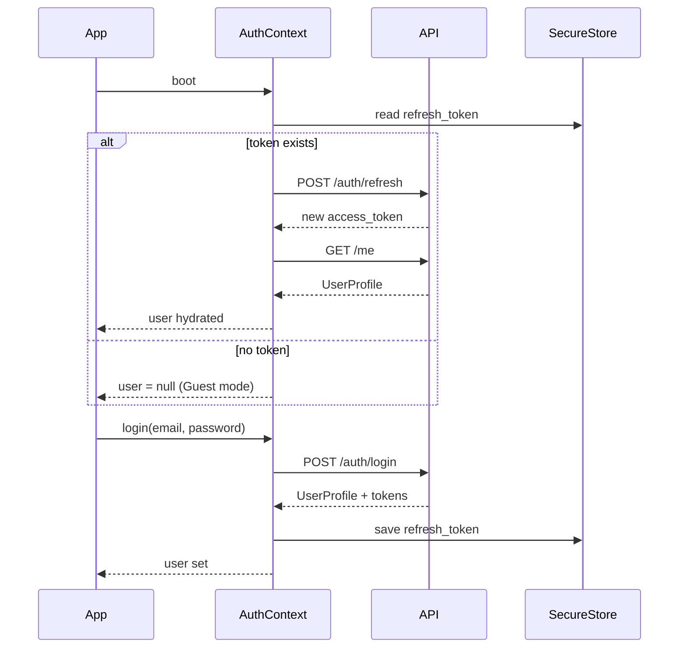
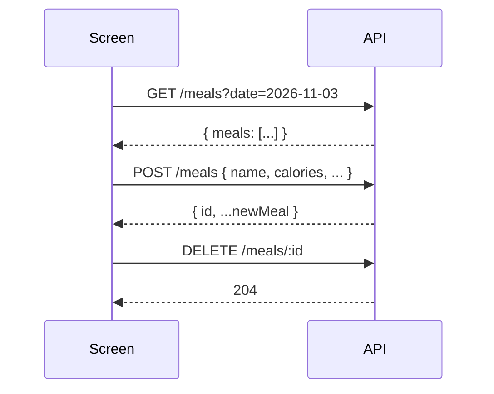

# MacroZone — Backend API Requirements

> This document describes every API endpoint the MacroZone mobile app needs, the exact request/response shapes derived from the current codebase, how the app will authenticate, and a migration guide from the current local-storage implementation.

---

## Current Architecture (Local-Only)

The app today uses `AsyncStorage` for everything — users, sessions, and meals are all stored on-device. The backend replaces two storage modules:

| Module | File | Replaces with |
|---|---|---|
| Auth storage | `src/storage/auth.ts` | `/auth/*` endpoints |
| Meals storage | `src/storage/meals.ts` | `/meals/*` endpoints |

The `AuthContext` (`src/context/AuthContext.tsx`) is the single integration point — all screens go through it. Swapping the storage layer behind the context is the only app-side work needed.

---

## Authentication Strategy

### Token Type
**JWT** (JSON Web Tokens), short-lived access token + long-lived refresh token.

### Storage on the device
| Token | Where | Why |
|---|---|---|
| `access_token` | In-memory (React state / context) | Never persisted; cleared on app close |
| `refresh_token` | `SecureStore` (expo-secure-store) | Survives app restarts; encrypted at rest |

### Request headers
Every authenticated request must include:
```
Authorization: Bearer <access_token>
Content-Type: application/json
```

### Token refresh flow
```
app boots
  → read refresh_token from SecureStore
  → POST /auth/refresh  →  new access_token
  → if 401 returned  →  clear tokens, show login screen
```

---

## Base URL

```
https://api.macrozone.app/v1
```

All paths below are relative to this base.

---

## Endpoints

### 1. Auth

#### `POST /auth/register`
Create a new user account.

**Request body**
```json
{
  "name": "Alex Rivera",
  "email": "alex@example.com",
  "password": "secret123",
  "dailyCalorieGoal": 2000,
  "dailyProteinGoal": 150,
  "dailyCarbsGoal": 250,
  "dailyFatGoal": 65
}
```

> [!NOTE]
> `dailyCalorieGoal`, `dailyProteinGoal`, `dailyCarbsGoal`, `dailyFatGoal` are **optional** — default to `2000 / 150 / 250 / 65` if omitted. The sign-up screen exposes an accordion to customise them.

**Response `201`**
```json
{
  "user": {
    "id": "usr_abc123",
    "name": "Alex Rivera",
    "email": "alex@example.com",
    "avatarUrl": null,
    "dailyCalorieGoal": 2000,
    "dailyProteinGoal": 150,
    "dailyCarbsGoal": 250,
    "dailyFatGoal": 65,
    "createdAt": "2026-11-03T12:00:00.000Z"
  },
  "access_token": "<jwt>",
  "refresh_token": "<jwt>"
}
```

**Error codes**
| Status | Reason |
|---|---|
| 409 | Email already registered |
| 422 | Validation failed (missing name, bad email, password < 6 chars) |

---

#### `POST /auth/login`
Sign in with email + password.

**Request body**
```json
{
  "email": "alex@example.com",
  "password": "secret123"
}
```

**Response `200`**
```json
{
  "user": { /* UserProfile — same shape as /auth/register */ },
  "access_token": "<jwt>",
  "refresh_token": "<jwt>"
}
```

**Error codes**
| Status | Reason |
|---|---|
| 401 | Wrong password |
| 404 | No account found for this email |

---

#### `POST /auth/refresh`
Exchange a refresh token for a new access token.

**Request body**
```json
{
  "refresh_token": "<jwt>"
}
```

**Response `200`**
```json
{
  "access_token": "<new jwt>",
  "refresh_token": "<rotated jwt>"
}
```

**Error codes**
| Status | Reason |
|---|---|
| 401 | Refresh token expired or revoked — redirect to login |

---

#### `POST /auth/logout`
Revoke the refresh token server-side.

**Request body**
```json
{
  "refresh_token": "<jwt>"
}
```

**Response `204`** No content.

---

### 2. User Profile

#### `GET /me`
Fetch the current user's full profile. Called on app boot after token refresh to hydrate `AuthContext`.

**Response `200`**
```json
{
  "id": "usr_abc123",
  "name": "Alex Rivera",
  "email": "alex@example.com",
  "avatarUrl": "https://cdn.macrozone.app/avatars/usr_abc123.jpg",
  "dailyCalorieGoal": 2000,
  "dailyProteinGoal": 150,
  "dailyCarbsGoal": 250,
  "dailyFatGoal": 65,
  "createdAt": "2026-11-03T12:00:00.000Z"
}
```

---

#### `PATCH /me`
Update name and/or daily macro goals. Used by the "Edit Daily Targets" modal and the user card edit flow.

**Request body** (all fields optional)
```json
{
  "name": "Alex R.",
  "dailyCalorieGoal": 2200,
  "dailyProteinGoal": 165,
  "dailyCarbsGoal": 225,
  "dailyFatGoal": 70
}
```

**Response `200`** — full updated `UserProfile` object (same shape as `GET /me`).

---

#### `PUT /me/avatar`
Upload a new profile photo. The app picks a local image URI via `expo-image-picker` and uploads it as `multipart/form-data`.

**Request** `Content-Type: multipart/form-data`
```
avatar: <image file>
```

**Response `200`**
```json
{
  "avatarUrl": "https://cdn.macrozone.app/avatars/usr_abc123.jpg"
}
```

> [!IMPORTANT]
> The app currently stores the local `file://` URI directly in AsyncStorage. When migrating to the backend, replace the local URI with the returned `avatarUrl` CDN URL and store that on the `UserProfile`.

**Error codes**
| Status | Reason |
|---|---|
| 413 | File too large (recommend 5 MB max) |
| 415 | Unsupported media type — only `image/*` accepted |

---

### 3. Meals

All meal endpoints are scoped to the authenticated user (derived from the JWT).

#### `GET /meals`
Fetch all meals for the current user, ordered newest-first. Used by the Home screen, All Meals screen, and the macro progress grid.

**Query parameters**
| Param | Type | Default | Description |
|---|---|---|---|
| `date` | `YYYY-MM-DD` | — | Filter to a specific calendar day (local date sent by the client) |
| `limit` | integer | `100` | Max results |
| `cursor` | string | — | Pagination cursor for next page |

**Response `200`**
```json
{
  "meals": [
    {
      "id": "meal_xyz",
      "name": "Grilled Chicken",
      "calories": 350,
      "protein": 45,
      "carbs": 0,
      "fat": 12,
      "createdAt": "2026-11-03T08:30:00.000Z"
    }
  ],
  "nextCursor": null
}
```

---

#### `POST /meals`
Log a new meal. Called when the user submits the Add Meal form.

**Request body**
```json
{
  "name": "Oatmeal",
  "calories": 320,
  "protein": 10,
  "carbs": 54,
  "fat": 6
}
```

> [!NOTE]
> `protein`, `carbs`, and `fat` default to `0` if omitted — matches current app behaviour (`Number(protein) || 0`).

**Response `201`**
```json
{
  "id": "meal_new123",
  "name": "Oatmeal",
  "calories": 320,
  "protein": 10,
  "carbs": 54,
  "fat": 6,
  "createdAt": "2026-11-03T09:00:00.000Z"
}
```

---

#### `DELETE /meals/:id`
Delete a single meal. Called by the swipe-to-delete / trash icon in `MealItem`.

**Response `204`** No content.

**Error codes**
| Status | Reason |
|---|---|
| 403 | Meal belongs to a different user |
| 404 | Meal not found |

---

#### `DELETE /meals`
Delete **all** meals for the current user. Called by "Clear All" in the Meals screen and "Clear All Meals" in Profile settings.

**Response `204`** No content.

---

## Data Models

### `UserProfile`

```ts
type UserProfile = {
  id: string;               // server-generated, e.g. "usr_abc123"
  name: string;
  email: string;            // immutable after registration
  avatarUrl: string | null; // CDN URL, null if not set
  dailyCalorieGoal: number; // default 2000
  dailyProteinGoal: number; // default 150
  dailyCarbsGoal: number;   // default 250
  dailyFatGoal: number;     // default 65
  createdAt: string;        // ISO 8601
};
```

### `Meal`

```ts
type Meal = {
  id: string;        // server-generated
  name: string;
  calories: number;
  protein: number;   // grams
  carbs: number;     // grams
  fat: number;       // grams
  createdAt: string; // ISO 8601
};
```

---

## How the App Consumes the API

### Client layer to create

Replace the two storage files with an API client. Recommended structure:

```
src/
  api/
    client.ts        ← axios/fetch instance, attaches Authorization header,
                       handles 401 → auto-refresh → retry
    auth.ts          ← wraps /auth/* endpoints
    meals.ts         ← wraps /meals/* endpoints
    me.ts            ← wraps /me endpoints
```

`AuthContext` calls `api/auth.ts` instead of `storage/auth.ts` — the rest of the app is untouched.

### Auth flow diagram



### Meal data flow diagram



---

## Error Handling Convention

The app currently surfaces errors via `Alert.alert('Error', error?.message)`. The API should return consistent error bodies:

```json
{
  "error": {
    "code": "EMAIL_TAKEN",
    "message": "An account with this email already exists."
  }
}
```

The `message` field maps directly to what the app shows in the alert — keep it user-readable.

---

## Guest Mode

The app allows unauthenticated use ("Guest Mode"). In guest mode:
- No API calls are made
- Meals are stored locally in `AsyncStorage` under the key `meals`
- When the user signs in or registers, the app should **offer to migrate** local guest meals to the server by `POST /meals` for each local meal before clearing `AsyncStorage`

---

## Avatar Upload — Implementation Notes

The current app stores a local `file://` URI. When connecting to the backend:

1. On `pickAvatar`, instead of calling `updateUserProfile({ avatarUri })`, call `PUT /me/avatar` with the file
2. On success, store the returned `avatarUrl` (CDN HTTPS URL) in the user profile
3. Use `expo-image`'s `<Image source={{ uri: avatarUrl }} />` — it handles remote URLs natively

For the upload itself, use `FormData`:

```ts
const formData = new FormData();
formData.append('avatar', {
  uri: localUri,
  name: 'avatar.jpg',
  type: 'image/jpeg',
} as any);

await fetch(`${BASE_URL}/me/avatar`, {
  method: 'PUT',
  headers: { Authorization: `Bearer ${accessToken}` },
  body: formData,
});
```

---

## Security Notes

> [!CAUTION]
> - **Never store the `access_token` in `AsyncStorage`** — use in-memory only. `AsyncStorage` is unencrypted.
> - Store only the `refresh_token` in `expo-secure-store` (uses iOS Keychain / Android Keystore).
> - Passwords are **never sent after login** — only JWTs are used for subsequent requests.
> - The backend should hash passwords with **bcrypt** (cost factor ≥ 12) — the current local implementation uses a trivial base64 mock.
> - Avatar uploads should be validated server-side for MIME type and size — do not trust the client `type` field.
